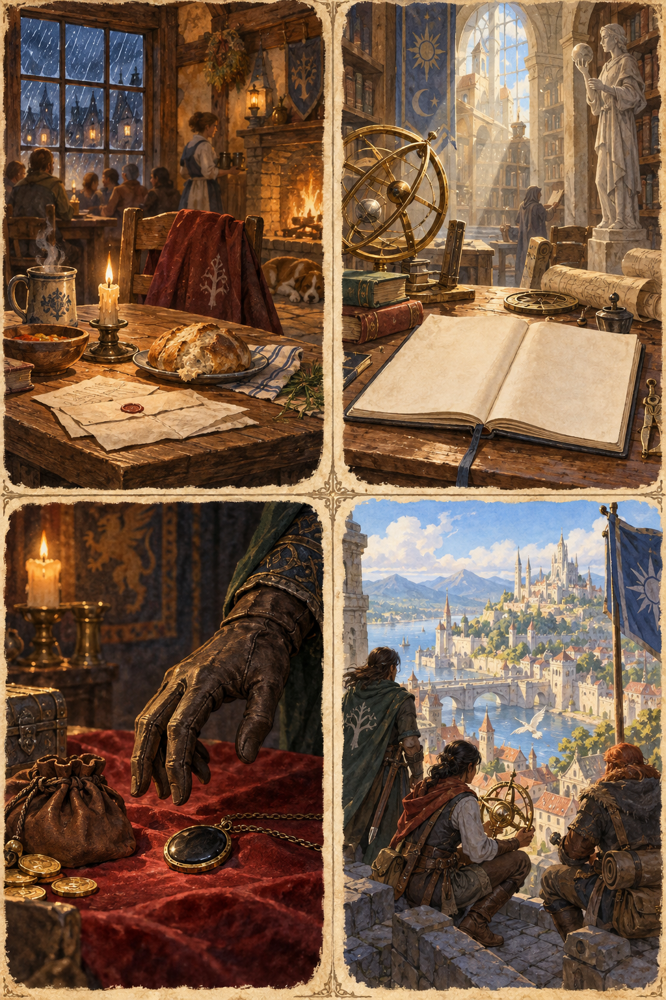
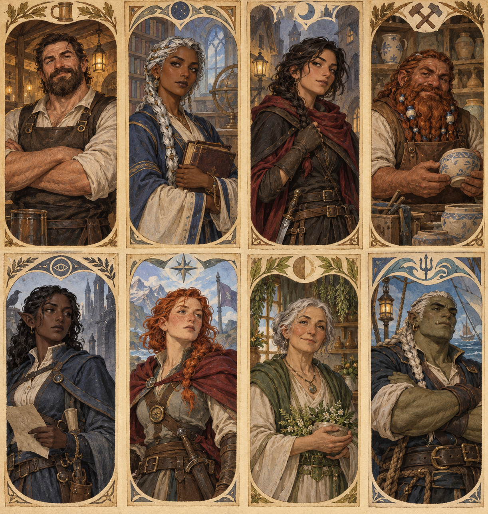
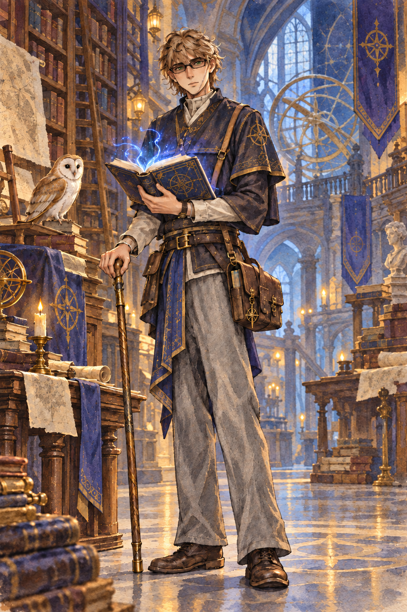

# The Echo Below

**Current checkpoint (26 September 2026):** Trista, Pebble, Donavan Kemp, Ringgo Paul, and Aldric Vane are level 3. Dracuseth stays in Waterdeep. Resume before entering the Redbrand hideout. See [current party](Current-Party.md) and [Sessions 2-3 actual record](Session-02-03-Actual-Recap.md). Everything described as a future scene remains planned.

## Campaign premise

*The Echo Below* begins as a rescue story near Phandalin and grows into a campaign about what people owe one another when knowledge becomes powerful enough to change a world. The party starts at level 1 in **Lost Mine of Phandelver**, reaches Waterdeep at roughly level 5, and uses the Yawning Portal as home while exploring **Dungeon of the Mad Mage** and the eight distant resonance sites.

The central mystery is the **Echo**: a two-part sensation. First comes a physical event - surf in a cave, a struck rope, a shifting stone. A heartbeat later comes a quiet pressure behind the eyes. That pressure is resonance from the knot in the Weave beneath Waterdeep. It is not a sound, a god, a portal network, or a promise that every mystery has one villain.

There are exactly nine sites: Undermountain at the center and eight satellites. The black-stone medallion, **Echo's Whisper**, records that relationship: one large center and eight smaller circles. It does not tell the party where to go, open doors, or grant finished powers. A named site can be dormant; studying it never automatically activates it.

## What the campaign is about

Waterdeep should feel worth protecting. Give the party meals, jobs, friendships, small celebrations, and people who expect them home. The dungeon and satellite sites should challenge that comfort with four recurring questions:

- **Home:** What makes a place worth returning to?
- **Curiosity:** What evidence is worth pursuing, and what must be protected while it is pursued?
- **Temptation:** What does a valuable or dangerous thing cost its keeper?
- **Responsibility:** Who bears the risk when a discovery affects ordinary people?

The answer must belong to the players. Do not make the Still Hand automatically correct, Halaster automatically all-knowing, or the knot a confirmed sentient villain. Make claims visible, let evidence complicate them, and make every consequential choice legible before it is irreversible.

## The opening: Phandalin to Waterdeep

Run the published opening normally. The Echo is seasoning, not a replacement for goblins, townsfolk, and Gundren's rescue.

### Session 1: Goblin Arrows

**Goal:** Find Gundren and Sildar after the ambush. Keep the encounter and Cragmaw Hideout as the immediate story. Gundren hired Trista because he trusts her after giving her a second chance; he hired Donavan because a careful field researcher can recognize whether a mine discovery is ordinary wealth or something that should be documented before it is sold; and he gave Ringgo a legitimate escort job in which keeping people alive matters more than making someone disappear. None of them begins with secret knowledge of the Echo.

**Historical Session 1 starting party:** Trista, Donavan, and Ringgo are joined by Pebble and Aldric Vane in Session 1. Aldric is a level-1 Reborn Wizard and former Crown magistrate seeking atonement and his lost family. His DM-built combat sheet is ready; Evocation begins at wizard level 2. Pebble seeks the delicious shiny rocks described by the dwarves who made his hammer and values traveling with others because he fears getting lost. Invite Bowman to describe why Aldric took Gundren’s job and give them equal say in the opening choices. Dracuseth remains in Waterdeep and is not on the wagon or in the opening encounters.

After the party's first quiet moment, place a rough black token among the goblins' castoffs. One side says **BELOW**. The reverse holds part of a worn circular mark. It is worth little money. A character who studies it notices that it feels cooler after a distant boom; no check is necessary, and it need not be important until the players choose to care.

At the hideout, add one sensory beat when water crashes through the cave: the physical boom lands, then a smaller magical pressure follows. Let it pass. Do not name the Echo or alter the published rescue stakes.

**Session 1 as played:** The five PCs completed Cragmaw Hideout, killed Klarg, and left Yeemik in charge after he released Sildar under their bargain. Sildar traveled with the party. They were told humanoid figures took Gundren but learned no destination. Trista privately kept the BELOW token; Donavan noticed her hide something without learning what it was. Aldric was revived with a hideout potion. After a long rest, the party stopped outside Barthen's Provisions before any delivery or town conversation. See the [actual play record](Session-01-Actual-Recap.md) for what is known and still open.

**DM-only Gundren continuity:** The figures were Redbrands. They abducted Gundren and delivered him to Cragmaw Castle. The party now knows that Redbrands have Gundren, but the castle destination has not been reported as learned. This changes the published capture route while preserving the castle destination.

### Sessions 2-4: Phandalin and the Black Spider

Redbrands, town relationships, Cragmaw Castle, and the mine remain the campaign's backbone. If a player searches Barthen's papers or Nezznar's discarded notes, offer an optional damaged fragment mentioning *Phandelver*, *resonance*, and *the Spider*. It is a lead, never a prerequisite.

Gundren is Trista's benefactor. He once paid a dangerous debt after she was caught stealing and told her, "Everyone deserves at least one person willing to bet on them." He acquired the medallion without understanding it and intended to consult her. Do not declare when or how Trista receives it until it happens in play. Donavan recognizes that the token's mark resembles a damaged research notation rather than a trade emblem, but its meaning lies outside even his broad academic training. That is a lead for his field notes, not a reason to solve the mystery at level 1.

### Sessions 5-7: Wave Echo Cave

At the Forge, the paired pressure becomes unmistakable. Nezznar has independently found the same pattern and recorded: *The echo is not unique. I have heard its twin beneath the mountain beneath the city.* His outcome remains open: he may talk, flee, die, or leave evidence behind.

The party's meaningful interaction with the Forge causes something beneath Waterdeep to respond. Halaster notices, but the players need not watch a cutscene. A recovered map or research note marks Waterdeep: **THE ECHO BELOW**. This earns the transition without explaining the Nine all at once.

## Waterdeep: a home that moves the story

Start each return with one welcome, one changed relationship, and no more than two actionable leads. The Yawning Portal gives food, rooms, messages, and Durnan's practical question: "Tell someone when you expect to be back." The Second Margin gives research. Ninepin Works gives careful repair. Blue Lantern Quay gives travel and hard-earned maritime knowledge. Lantern House gives people who feel consequences first.

Use the detailed [Waterdeep Hub](../waterdeep/Waterdeep-Hub.md) as the city chapter. Its eight recurring figures are deliberately distinct:

| Person | What they offer | What they want protected |
|---|---|---|
| Durnan | a home and grounded judgment | people who leave through the well |
| Selise Ardent | precise research | careful proof and her students |
| Mara Vey | criminal access and a personal test for Trista | agency, profit, and not being treated as a lesson |
| Orren Brassmantle | instruments and repair | consent before destructive testing |
| Ilvara Reed | civic records and quiet help | sources, civilians, and responsible disclosure |
| Kestrel Dane | rivalry and expeditions | recognition and her crew |
| Sister Anja Vale | care and the severance argument | people closest to a failed experiment |
| Captain Rusk Vess | routes, logistics, and witness accounts | honest rescue plans and sailors' lives |

The **Still Hand** wants to isolate or sever the network. Its evidence supports caution: deliberately tuning recovered parts makes the response grow. It does not prove that investigation itself empowers Halaster. Anja's care is real even when her conclusion differs from the party's.

## The first Waterdeep sessions

### The first supper

Rain rattles the Portal windows. Durnan asks for a return date. Mara joins the table without asking, returns a small item lifted from Trista years ago, and asks after Gundren. The outcome is a home, a relationship, and a reason to visit Selise - no required fight.

### The book that remembers

At Second Margin, a blank gray-linen book reacts near the medallion. Selise repeats the experiment openly and asks permission before copying anything. Its text is: **THE FIRST IS BENEATH YOU. THE SECOND ECHOES IN THE MINE. THE THIRD HAS FORGOTTEN HOW TO SPEAK.** A building deed reveals the hidden stair to the Silent Library. Players may enter now, secure it, or prepare first.

### A quiet accusation

Later, evidence links a broker behind Mara's theft contract to supplies delivered at Lantern House. Anja presents one documented accident and one uncertain inference in the hospice courtyard. End with a decision about a supervised test, evidence-sharing, or refusal - never a compulsory betrayal scene.

## Character spotlights

**Expanded DM preparation:** [Five character stories and spotlight guide](Five-Character-Stories.md) contains 30 optional scenes, evidence checks, choices, and fallbacks. In the app, open Story > Character stories & spotlights. Offered hooks are not completed history; record outcomes separately.

**Aldric update:** the DM chose a connection between Halaster and Aldric's return from death. The new guide prepares a return experiment and a corroborated discovery path. This is custom campaign material, currently unrevealed. Halaster does not control Aldric, and this does not make him responsible for the Crown's crimes or Nezznar's plans.

### Trista: the person Gundren bet on

Trista is central through Gundren, Mara, charity, her criminal instincts, and Echo's Whisper. Her oversized monk robes, calm bearing, and watchful eye make her easy to underestimate; the campaign should reward her when she notices what people hide and chooses what to do with it. Mara is not a moral lesson or a compulsory betrayal. Her theft contract creates a fair, visible pressure between loyalty, fear, and value.

Trista's strongest campaign question is: **when something powerful comes into her hands, who does she become responsible for?** Gundren's faith gave her a way forward. The medallion tests whether she can protect a dangerous thing without letting it define her. Let her charity create practical relationships: thank-you notes at the Portal, people willing to testify for her, or a community she has already helped when a later danger reaches it.

### Donavan Kemp: the field researcher who must bring knowledge home

Donavan is a 25-year-old Neutral Good human wizard, sage, and field researcher from the **Kemp Archive and Arcane University**, a library and university in an elven metropolis. He has spent seven years gathering reliable accounts from places where the truth is incomplete or inconvenient. He has tousled light-brown hair, green eyes behind narrow dark spectacles, a long walking staff, a crowded scholar's satchel, and a barn owl familiar. He favors black, gold, blue, and purple. The Fey Realm is one of the multiversal places he hopes to explore, not the Archive's home.

His home is not an abstraction. His wife **Dianna Kemp**, a blue tiefling mathematician, teaches at the Archive. His uncle **Favian** taught him that written magic can reveal the ordered structure of the Weave. His mother Vivian and siblings Lilian, Conner, and Nilla remain part of the family institution; his father Markus is dead, while the truth of that death stays open. Donavan now follows the Order of Scribes tradition, but this campaign treats every accurate record and hard-won translation as a step toward it rather than handing him a finished answer.

Donavan's strongest campaign question is: **can he pursue a discovery powerful enough to change magic without allowing it to control him?** The Echo and Looking Glass give that question real stakes. He should be the party member who labels claims, compares sources, sketches ruins, and notices who benefits when a record disappears. He is also the person who steps forward when someone with power humiliates or exploits someone weaker.

### Ringgo Paul: the weapon who chooses what he is for

Ringgo is a 30-year-old tiefling rogue from Baldur's Gate and a former assassin trying to escape the criminal world that trained him. He is tall and solidly built, with purple skin, dark-purple hair, green eyes, studded leather, and the tools of a spy and burglar. His strongest talents are speed, stealth, deception, and reading the practical dangers in a room. He does not begin with secret knowledge of the Echo, the Still Hand, or Halaster.

Ringgo's strongest campaign question is: **can he use the skills that made him dangerous without allowing those skills to decide who he remains?** Give him honest work, people whose trust cannot be bought, and situations where restraint is harder than violence. His former profession may produce contacts, rumors, or recognition in Baldur's Gate, Waterdeep, and Skullport, but no old employer is automatically part of the Still Hand or Halaster's network. Cade chooses the particular contract or event that finally made Ringgo leave; the dock-clerk-and-ledger incident is an optional version, not established history.

### Pebble: the mountain beyond the map

Pebble came down from his Goron home because the dwarves who made his hammer described shiny stones that might taste wonderful. The supply escort gives him company and a route toward Phandalin's mines. His fear of getting lost is real, but curiosity usually carries him forward. Let Byron decide what he eats, how he asks for help, and whether the rumored stone turns out to be a mineral, a mistaken tale, or something worth protecting. Do not make Pebble's appetite an automatic way to identify an Echo site or consume a plot-critical artifact.

In Waterdeep, give him places and people that make an unfamiliar city navigable: a reliable meeting place, a craftsperson who appreciates his hammer, and companions who remember his preferred route home. At a distant site, he can choose whether discovery is worth the risk of losing the people who helped him find his way. He meets the other PCs during Session 1; none has a preassigned connection to him.

### Aldric Vane: a second life and an unfinished debt

Aldric was a Crown battle mage and magistrate who obeyed orders that harmed innocents while his family was threatened. After he worked against the Crown, he was killed and returned as a Reborn with broken memories. His signet ring, dread of smoke, and longing for faces he cannot picture are personal facts; the Crown's identity, his family names, and the detailed political history remain open. His return is now linked to Halaster by the DM’s chosen direction; the experimental explanation in the new guide remains private preparation. Bowman decides when the party learns his history and what atonement means in play.

Give him chances to protect people without repeating the Crown's methods, and records that might eventually help recover his family's names. Waterdeep's archives and civic contacts can be leads if Bowman pursues them. His old battle instincts may make overwhelming magic tempting, but never force that choice or turn the other PCs into judges of his redemption. He is now a level-3 Evocation Wizard under the campaign's 2014 rules.

### The shared story

All five characters give the party different reasons to care about the same mystery. Pebble and Aldric joined in Session 1. Pebble's search for a delicious shiny rock and fear of getting lost can open a personal thread; Aldric’s fragmented memories and atonement can become a spotlight, but Bowman decides when to reveal them. Do not make the Crown or his return from death secretly part of the Echo by default. Trista understands that an object can become personal before its history is known. Donavan understands that an artifact's history affects everyone who may be harmed by its use. Ringgo understands that information can become a weapon before anyone admits they are wielding it. None gets final authority: Trista decides what she will carry; Donavan decides what he will publish or hold back; Ringgo decides which methods he will refuse to repeat; the party decides together what they will risk.

Give the five PCs a road scene before the ambush. Gundren asks Donavan to keep an honest account of anything unusual at the mine, asks Trista to make sure he returns to read it, and asks Ringgo to choose the safest camp rather than the fastest one. Later, at the Silent Library, Donavan's catalogue work, Trista's eye for hidden access, and Ringgo's route discipline produce several valid approaches: preserve the archive in place, rescue its fragile record, or secure a path for later study. None is automatically right.

PanikStrikez25 controls whether Trista accepts custody of Echo's Whisper when it is recovered. Brodey can decide the barn owl's name, the reason for Donavan's spectacles and staff, the truth of Markus's death, and the discovery Donavan most fears to share with the Archive. Cade decides Ringgo's breaking-point contract, the people from his old life who still matter, and how openly he names his former profession. Reserve the Hollow Mountain for a consequence that grows from actual play, not a predetermined family secret.

### Mechanical source of truth

Each live character sheet is authoritative for that character's mechanics. Trista uses her 2024 Monk sheet. Ringgo's current sheet uses legacy rogue and tiefling features while displaying 2024 Nick and Vex labels; ignore those mastery properties unless the DM explicitly grants Weapon Mastery. Donavan follows his own live sheet. Mixed rules versions are allowed, but any conversion or harmonization must be an explicit table decision rather than a silent rewrite.

## Advancement and the long shape

Use milestones: level 1 at the start; roughly level 5 after Wave Echo Cave; then growth through substantial accomplishments across Undermountain and satellite journeys, reaching 17-20 at the finale. Dungeon floor numbers are not character levels. The [Undermountain roadmap](Undermountain-Roadmap.md) overlays the published adventure without replacing its maps, inhabitants, or room keys.

The [six satellite adventures](Site-Adventures.md) cover Sites 3-8. They are expandable two-session excursions with fail-forward clues and choices that affect later options. Site 9, the Hollow Mountain, remains intentionally unlocated until the party makes it meaningful.
