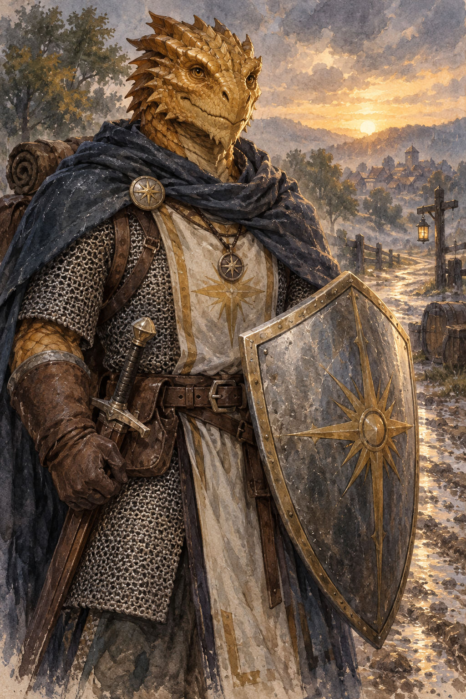

# Dracuseth Maw of Flames

*Level 4 gold dragonborn paladin (Oath of Devotion) • Folk Hero • Waterdeep contact*

The sunburst-like shield emblem is his personal oath mark; the portrait does not establish a patron deity.

Dracuseth lives in Waterdeep and may become a contact at the Yawning Portal or a volunteer at Lantern House. He does not accompany the wagon, join Session 1 combat, or take a starting-party turn. Keep his sheet as a private reference if the party meets him later.

## At the table

**On the [updated table-ready sheet](../pdf/Dracuseth-Maw-of-Flames-Character-Sheet.pdf):** Strength 13, Dexterity 13, Constitution 17, Intelligence 9, Wisdom 12, Charisma 17; 40 maximum HP; 30-foot speed; proficiency bonus +2; spell save DC 13; spell attack +5. He has chain mail, a shield, a longsword, six javelins, a holy symbol, and 19 gp. He has 20 points of Lay On Hands healing, three 1st-level spell slots, and two uses of Channel Divinity per long rest, with one use recoverable after a short rest. His gold ancestry grants fire resistance and a fire breath weapon (two uses per long rest at this level, 1d10 damage, Dexterity save DC 13). He knows Mending and Spare the Dying through Blessed Warrior.

**Use the shield.** The PDF's AC 16 reflects chain mail alone. With his listed shield equipped, Dracuseth's AC is **18**. His Strength meets the armor's requirement, so his speed remains 30 feet. In the 2024 rules, donning or doffing a shield takes a Utilize action; have it ready before trouble starts.

**Longsword:** +3 to hit, 1d8 + 1 slashing with one hand. Its Sap mastery makes the creature he hits have Disadvantage on its next attack roll before the start of Dracuseth's next turn. He has **one** attack with the Attack action at level 4. When he invokes Sacred Weapon, his Charisma modifier adds +3 to melee attack rolls with that weapon for 10 minutes, making the longsword **+6 to hit** while it lasts. The listed Push mastery cannot be used until he actually has a warhammer.

### Reference use

The revised sheet preserves his 2024 Paladin build for a possible Waterdeep scene. Any aid he offers should fit what the players ask for and what he can plausibly do in the city. Do not automatically assign his Inspiring Leader temporary HP, Bless, or healing to the Session 1 party.

## Character and campaign fit

**Folk-hero story:** Raiders burned a roadside granary. Dracuseth's breath drove attackers away from the exits, but he stayed in the smoke until the last family was safe. Witnesses called him “Maw of Flames.” The name once embarrassed him; now he keeps it because it steadies frightened travelers. He took the Oath of Devotion afterward, promising to tell the truth, defend the vulnerable, and never use fear to force obedience.

**Traits, ideal, bond, flaw:** He counts people before supplies and makes sure the quietest traveler has eaten. He believes strength should give others room to choose. He feels bound to ordinary people who cannot afford protectors. His flaw is taking responsibility too quickly: he can mistake carrying everyone's burden for helping and must learn to ask before stepping in.

**Voice:** Plainspoken, dry, and warm. “Who is still missing?” “You do not need to be brave alone.” “I can hold the door. You decide where we go.”

**A simple introduction:** At the Yawning Portal or Lantern House, the party hears of a gold dragonborn volunteer called the Maw of Flames, known for helping ordinary people escape danger. Introduce him only when the players encounter him in Waterdeep. He knows nothing secret about the medallion, the Echo, Halaster, or the Still Hand. Let his relationships with Trista, Donavan, Ringgo, and Pebble and Aldric develop through play.

**At the Yawning Portal:** Dracuseth may ask whether the party has told someone when they expect to return. He can help at Lantern House as a volunteer, but has no prior knowledge of Anja or her hidden affiliations. If the players argue over what to do with the Echo, he can describe the human cost of either choice, then let **the party** decide.

## DM use

Keep Dracuseth off the Session 1 battle maps and initiative order. In Waterdeep, use him as a recurring person with his own commitments rather than automatic extra party strength. If the players invite him into a later encounter, review that encounter with his level-4 abilities in mind.

**Source of truth:** The updated table-ready PDF above is Dracuseth's current play sheet for this campaign. The original D&D Beyond export is unchanged and will not reflect the new feat, Charisma score, AC, or prepared spells unless it is edited in D&D Beyond too. His personal history is campaign material that the DM can still adjust at the table.
