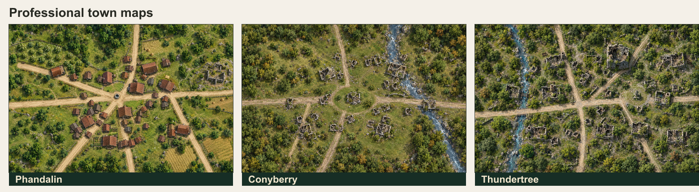

# Professional town maps

The app now uses these realistic, player-facing overhead maps. They are for **settlement exploration** and use the app's location markers without a battle grid. The original schematic SVGs remain available.

| Place | Professional map | Original layout | Use in the app |
|---|---|---|---|
| Phandalin | [PNG](town-maps/professional/phandalin-overhead.png) | [SVG](town-maps/phandalin-overhead.svg) | Open the **Town map · Phandalin** scene when the party arrives or explores town. |
| Conyberry | [PNG](town-maps/professional/conyberry-overhead.png) | [SVG](town-maps/conyberry-overhead.svg) | Open the **Town map · Conyberry** scene when the abandoned settlement comes into view. |
| Thundertree | [PNG](town-maps/professional/thundertree-overhead.png) | [SVG](town-maps/thundertree-overhead.svg) | Open the **Town map · Thundertree** scene as the party explores its ruins. |

The app keeps location names and private DM notes in its markers, rather than printing them into the art. Hidden markers remain hidden until revealed. These maps are approximate orientation views; use the adventure's keyed maps for exact room or encounter locations. The detailed [Thundertree battle maps](LMOP-Battle-Map-Guide.md) are available when combat starts.

The [image generation prompts](town-maps/Professional-Town-Map-Prompts.md) are saved with the art.

The wider region is available from **Journey map**, using the new [painted Phandelver map](Phandelver-Journey-Map-Guide.md) with optional ambient motion and revealable story locations.
